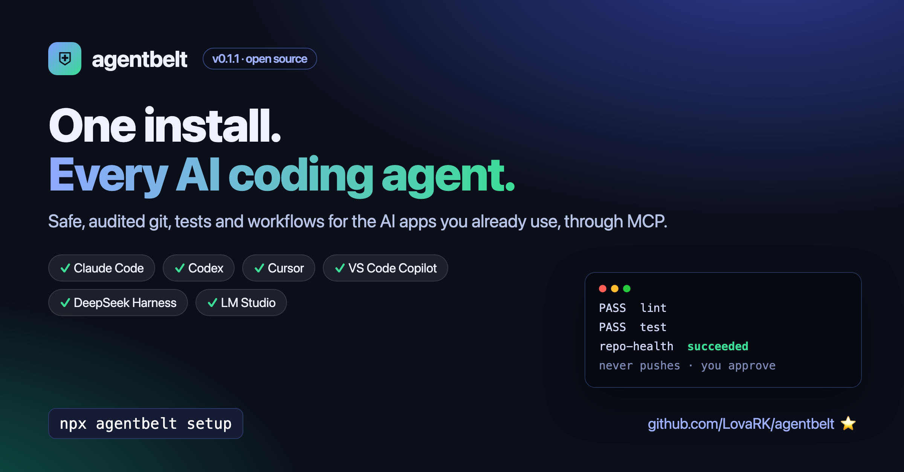
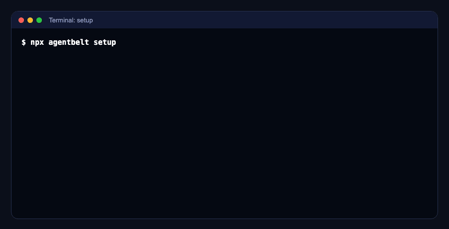

# agentbelt

[](https://www.npmjs.com/package/agentbelt) [](https://github.com/LovaRK/agentbelt/actions/workflows/ci.yml) [](LICENSE)

<p align="center"></p>

**One install. Every AI agent. Safe tools for your real dev work.**

⭐ If agentbelt is useful to you, [star the repo](https://github.com/LovaRK/agentbelt) so more developers can find it. · 📖 [Guide](https://lovark.github.io/agentbelt/) · ✍️ [Why I built it](https://medium.com/@plovark/one-toolbelt-for-every-ai-coding-assistant-why-i-built-agentbelt-8003208f22f1)

agentbelt gives your AI coding apps the same set of safe, audited tools:

- **git** with isolated task branches;
- the project's own **tests and checks**;
- **workflows** with approval gates.

You write them once, and they run everywhere through the Model Context Protocol (MCP). No API key and no extra LLM are needed: your AI app brings the model, agentbelt brings the tools.

<p align="center"></p>

```bash
npx agentbelt@0.3.0 setup
```

`setup` takes under a minute:

1. It installs a pinned copy, with package install scripts disabled.
2. It **verifies the copy with real tool calls** before activating it.
3. It finds your AI apps (Claude Code, Codex, Cursor, VS Code, DeepSeek Harness, LM Studio, Claude Desktop, Goose), shows you each config change, and backs up each config file before changing it.

## Works with

| App                  | Status                                                                  | How it connects                                                                                                              |
| -------------------- | ----------------------------------------------------------------------- | ---------------------------------------------------------------------------------------------------------------------------- |
| **DeepSeek Harness** | ✅ verified 2026-11-13 with 0.2.2-rc.1: real tool calls                 | `@deepseek-ai/dsh-mcp-client` entry in your profile; needs `setup --workspace <project>` (DeepSeek gives servers no project) |
| **Claude Code**      | ✅ verified 2026-11-12 with Claude Code 2.1.257: real tool calls        | `claude mcp add-json --scope user`                                                                                           |
| **Codex**            | ✅ verified 2026-11-12 with codex-cli 0.166.0: real tool calls          | `codex mcp add`                                                                                                              |
| **Cursor**           | ✅ verified 2026-11-13 with 3.30: real tool calls (open a folder first) | `mcpServers.agentbelt` in `~/.cursor/mcp.json` (project from MCP roots: open a folder)                                       |
| **VS Code**          | ✅ verified 2026-11-13 with 1.142 (Copilot agent mode)                  | `servers.agentbelt` in the user `mcp.json` (project from MCP roots)                                                          |
| Claude Desktop       | config written by `setup`; not yet verified with a real call            | `mcpServers.agentbelt` in `claude_desktop_config.json`; needs `--workspace`                                                  |
| **LM Studio**        | ✅ verified 2026-11-13 with 0.4.28 (turn on `mcp/agentbelt` in chat)    | `mcpServers.agentbelt` in `~/.lmstudio/mcp.json`; needs `--workspace`                                                        |
| Goose                | config written by `setup`; not yet verified with a real call            | `extensions.agentbelt` in `~/.config/goose/config.yaml`; needs `--workspace`                                                 |
| Any MCP client       | stdio server                                                            | command `~/.local/share/agentbelt/bin/agentbelt`, args `["serve"]`                                                           |

"Verified" means the app called agentbelt tools in a real session and the result was checked in agentbelt's audit log, not just that a connection was made. See [docs/compatibility.md](docs/compatibility.md).

## What your AI can do with it

| Tool                                                                    | What it does                                                                                                |
| ----------------------------------------------------------------------- | ----------------------------------------------------------------------------------------------------------- |
| `git_status`, `git_diff`, `git_log`                                     | Read the repository                                                                                         |
| `git_task_start`                                                        | Create an isolated task: a worktree in `.agentbelt/worktrees/<id>` on branch `agentbelt/<id>`               |
| `git_commit`                                                            | Commit a task's changes to its `agentbelt/<id>` branch, never to your current branch, and **never push**    |
| `testing_detect`, `testing_run_checks`                                  | Find and run the project's own typecheck, lint, build and tests (npm, pnpm, yarn, Swift, Cargo, Go, pytest) |
| `workflows_list`, `workflows_start`, `workflows_show`, `workflows_runs` | Multi-step recipes like `check`, `repo-health` and `safe-commit`                                            |
| `agentbelt_status`                                                      | Workspace, plugins, and how commands are isolated                                                           |

**Skills** (in the Agent Skills format) come along as MCP prompts:

- `fix-failing-tests`
- `review-diff`
- `pr-description`
- `repo-health`
- `safe-dependency-update`

### Try it

Open your AI app in a project and say:

- _"Use agentbelt to run the checks and fix what fails."_
- _"Review my uncommitted changes with agentbelt."_
- _"Start the safe-commit workflow for task fix-login-1a2b3c."_

## Safety model

agentbelt is built so that a confused or manipulated model can't do much damage.

- **Permissions are enforced on every action.** Plugins never touch the system directly. Every command, file read or write, and cross-tool call goes through a broker that checks the plugin's declared permissions and the core command policy:
  - arguments are passed as a list, never through a shell;
  - each program is limited to a list of allowed subcommands;
  - paths can't leave the project or reach `.git`.
- **No pushes, no destructive git.** `push`, `fetch`, `reset`, `checkout`, `rebase`, `clean` and `config` are not allowed. Commits only go to `agentbelt/*` task branches.
- **You decide approvals.** Workflow approval gates can only be decided with `agentbelt approve` in your terminal. There is no tool for it, so the model can't approve its own work.
- **Everything is audited.** Each call is logged to `.agentbelt/audit.jsonl`, with secrets redacted. See it with `agentbelt audit`.
- **Honest isolation labels.** Built-in plugins run as `policy-only`: the permission and command checks apply, but there is no OS sandbox. Project test scripts are your project's own code, and they run like they would in your terminal.
- **Third-party plugins run only in an OS sandbox.** The sandbox has no network, no access to your files and no secrets in the environment. Their only way to act is the broker:
  - They are installed with **package scripts disabled**, and pinned to a hash of the reviewed files.
  - If no sandbox is available (macOS `sandbox-exec` or Linux bubblewrap), they are **refused**. agentbelt never falls back to running untrusted code with only policy checks.

Read [SECURITY.md](SECURITY.md) for the full model and its limits.

## Updates you control

```bash
agentbelt update      # shows the new version, installs it next to the current one, verifies it, then switches
agentbelt rollback    # instant switch back to the previous version (always kept)
agentbelt doctor      # checks the install and makes real tool calls through it
agentbelt uninstall   # removes agentbelt from your apps (config backups are kept)
```

Nothing updates automatically. Your apps run a pinned version through a small shim, and a new version becomes active only after it passes verification. The switch is atomic.

## Workflows

A workflow is JSON: steps call tools, and `approval` steps wait for you.

```json
{
  "name": "safe-commit",
  "inputs": { "task": "", "message": "" },
  "steps": [
    { "id": "checks", "uses": "testing_run_checks", "with": { "task": "${inputs.task}" } },
    { "id": "review", "approval": "Commit ${inputs.message}?", "needs": ["checks"] },
    {
      "id": "commit",
      "uses": "git_commit",
      "with": { "task": "${inputs.task}", "message": "${inputs.message}" },
      "needs": ["review"]
    }
  ]
}
```

Put your own workflows in `<project>/.agentbelt/workflows/*.json`. Workflows run only when you (or your AI app at your request) start them, or when you opt in to the scheduler (below).

## Optional extras (off by default)

- **Coding agent:** `agentbelt agent setup --provider local --model <name>` (or `--provider deepseek`, or `custom --base-url …`). Your AI app can then hand a task to that model with `agent_run`. The key goes to the OS keychain. Verified with a local Ollama model (gpt-oss 20B); the DeepSeek API path is tested with a fake endpoint only.
- **Token optimization (0.2.0):** for long agent runs on small-context local models, `agent_run` with `compact: true` shortens older tool results (keeps the lines that matter to the task and drops repeated outputs) before each model call. `agentbelt tokens` and the `tokens_report` tool show the input and output tokens the model server reported per run, with compaction off and on. Measured results, including where it did not help: [docs/token-optimization.md](docs/token-optimization.md).
- **Scheduler and triggers:** `agentbelt schedule add repo-health --cron "0 9 * * 1-5"`, `agentbelt trigger add repo-health --on git --branch main`, then keep `agentbelt scheduler run` going. Only file and git triggers; nothing runs unless you start the scheduler.

## Plugins

```bash
agentbelt plugin list
agentbelt plugin add <npm-package | ./plugin.tgz>   # shows requested permissions; you approve
agentbelt plugin remove <name>
```

To write one, see [docs/plugins.md](docs/plugins.md). A plugin is a name, its permissions and a list of tools.

## Requirements

- Node.js 22.13 or newer, and git.
- macOS or Linux. Third-party plugins need an OS sandbox: `sandbox-exec` on macOS, or bubblewrap (`bwrap`) on Linux with unprivileged user namespaces allowed.

## Contributing

Issues and pull requests are welcome. See [CONTRIBUTING.md](CONTRIBUTING.md). Good first contributions include:

- an adapter for another MCP client (for example Goose);
- a new skill;
- a test runner for another ecosystem.

## License

[Apache-2.0](LICENSE)
