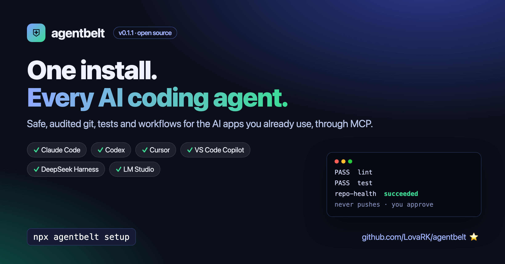

# agentbelt



**One install. Every AI agent. Safe tools for your real dev work.**

agentbelt gives the AI apps you already use (Claude Code, Codex, Cursor, VS Code, DeepSeek
Harness, LM Studio) one shared set of safe, audited developer tools: git with isolated task
branches, your project's own tests and checks, and multi-step workflows with approval gates. It
speaks the Model Context Protocol (MCP), so you set it up once and every app gets the same tools.

No API key and no extra model: your AI app brings the model, agentbelt brings the tools.

[GitHub](https://github.com/LovaRK/agentbelt) ·
[npm](https://www.npmjs.com/package/agentbelt) ·
[Security model](https://github.com/LovaRK/agentbelt/blob/main/SECURITY.md) ·
[Compatibility](https://github.com/LovaRK/agentbelt/blob/main/docs/compatibility.md)

## Get started in one minute

You need Node.js 22.13 or newer and git, on macOS or Linux.

```bash
npx agentbelt setup
```

Setup:

1. installs a pinned copy with package install scripts turned off;
2. **checks that copy with real tool calls** before switching to it;
3. finds your AI apps, shows each config change, and backs up every file before changing it.

Some apps don't tell tool servers which project is open (DeepSeek Harness, LM Studio, Claude
Desktop). For those, name the project:

```bash
npx agentbelt setup --workspace ~/code/my-project
```

## Use it

Open your AI app in a project and ask in plain words:

- "Use agentbelt to run the checks and fix what fails."
- "Review my uncommitted changes with agentbelt."
- "Run the repo-health workflow with agentbelt."

A quick test that everything works:

> Use the agentbelt tools only. 1) Call testing_run_checks. 2) Call workflows_start with name
> repo-health. Then tell me the exact PASS/FAIL lines and the final run state.

You should see real `PASS` lines from your project's own lint and tests, and a run that ends
`succeeded`.

### App notes

| App              | Tip                                                                 |
| ---------------- | ------------------------------------------------------------------- |
| Claude Code      | Works in any project folder.                                        |
| Codex            | Codex asks before running tools that change things; approve them.   |
| Cursor           | Open a folder first (File → Open Folder). Use Agent mode.           |
| VS Code          | Copilot Chat in **Agent** mode; allow the tool calls.               |
| DeepSeek Harness | Set up with `--workspace <project>`.                                |
| LM Studio        | Set up with `--workspace`; in each chat, turn on `mcp/agentbelt`.   |
| Claude Desktop   | Quit Claude first, then set up with `--workspace`. (Not yet tested) |

Every app above except Claude Desktop was tested with real tool calls, confirmed in
agentbelt's audit log.

## What your AI gets

| Tools                                                          | What they do                                                       |
| -------------------------------------------------------------- | ------------------------------------------------------------------ |
| `git_status`, `git_diff`, `git_log`                            | Read the repository                                                |
| `git_task_start`, `git_commit`                                 | Work in an isolated task branch (`agentbelt/<id>`); **never push** |
| `testing_detect`, `testing_run_checks`                         | Run the project's own typecheck, lint, build and tests             |
| `workflows_list`, `workflows_start`, `workflows_show`, `_runs` | Multi-step recipes like `check`, `repo-health`, `safe-commit`      |
| `agentbelt_status`                                             | Workspace, plugins, and how commands are isolated                  |

Plus ready-made prompts (skills): `fix-failing-tests`, `review-diff`, `pr-description`,
`repo-health`, `safe-dependency-update`.

## Why it's safe

- **Every action is checked.** Commands run without a shell, each program is limited to allowed
  subcommands, and file paths can't leave the project.
- **No pushes, no destructive git.** `push`, `reset`, `rebase`, `clean` and similar are blocked.
  Commits only go to task branches.
- **You approve.** Workflow approval steps can only be approved by you, in your terminal
  (`agentbelt approve`). The model has no tool to approve its own work.
- **Everything is logged.** Each call goes to `.agentbelt/audit.jsonl`, with secrets removed.
  View it with `agentbelt audit`.
- **Honest labels.** Built-in tools are "policy-only": checked, not OS-sandboxed.
  Third-party plugins run only inside an OS sandbox (macOS `sandbox-exec`, Linux bubblewrap) with
  no network, or they don't run at all.

## Stay in control of updates

```bash
agentbelt update     # installs the new version next to the old one, checks it, then switches
agentbelt rollback   # switch back to the previous version instantly
agentbelt doctor     # check the install with real tool calls
agentbelt uninstall  # remove agentbelt from your apps (backups are kept)
```

Nothing updates by itself.

## Optional extras (off by default)

- **Local coding agent:** `agentbelt agent setup --provider local --model <name>` lets your AI
  app hand a task to a local model (Ollama, LM Studio) or DeepSeek. Keys go to your OS keychain.
- **Scheduler:** `agentbelt schedule add repo-health --cron "0 9 * * 1-5"` and
  `agentbelt scheduler run` run workflows on a timetable or when files or git change.

## Write your own

- **Workflows:** JSON files in `<project>/.agentbelt/workflows/`. Steps call tools; `approval`
  steps wait for you.
- **Plugins:** a name, its permissions and a list of tools. See the
  [plugin guide](https://github.com/LovaRK/agentbelt/blob/main/docs/plugins.md).

---

Apache-2.0 · Built by [LovaRK](https://github.com/LovaRK) ·
[Report an issue](https://github.com/LovaRK/agentbelt/issues)
